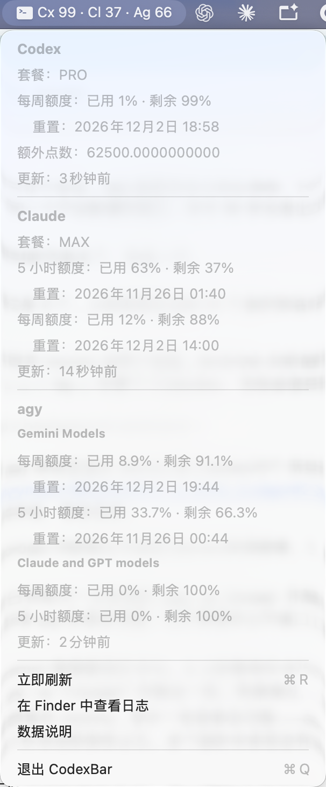

# CodexBar

CodexBar 是一个原生 macOS 菜单栏应用，同时显示 Codex、Claude Code 和 Google Antigravity CLI（agy）的剩余额度。

## 效果预览



## 功能

- 菜单栏并排显示三个工具的剩余百分比，例如 `Cx 99 · Cl 96 · Ag 100`，没有数据时显示 `--`
- 下拉菜单显示 Codex 和 Claude Code 的套餐，以及各工具额度窗口的已用和剩余比例、重置时间及更新时间。agy 显示 Gemini 和 Claude/GPT 两组的每周额度和 5 小时额度
- Codex 每 5 秒读取本地日志，Claude Code 每 60 秒查询额度，agy 每 5 分钟查询额度，也可点击“立即刷新”
- 支持 Codex 返回的主要/次要额度和额外点数
- 自动识别 `~/.codex/sessions`，也支持 `CODEX_HOME`
- 无 Dock 图标，原生 AppKit，macOS 13 及以上

## 构建与运行

只需要 Apple Command Line Tools，不要求安装完整 Xcode：

```bash
./scripts/run.sh
```

`scripts/swift.sh` 会自动选择本机可用的 macOS SDK，兼容 Command Line Tools 中编译器与最新 SDK 小版本暂时不同步的情况。

打包成 `.app`：

```bash
./scripts/package-app.sh
open ./dist/CodexBar.app
```

安装到 `~/Applications`：

```bash
./scripts/install.sh
```

安装并设置登录时自动启动：

```bash
./scripts/install.sh --login
```

卸载（应用与启动项会移动到废纸篓）：

```bash
./scripts/uninstall.sh
```

## 第一次没有数据显示？

Codex 只有在完成请求并收到服务端额度状态后才会把 `rate_limits` 写入任务日志。先在 Codex Desktop 或 Codex CLI 中运行一次普通任务，再点击菜单中的“立即刷新”。

如果 Claude Code 提示登录已失效，在终端运行 `claude` 并登录，再点击“立即刷新”。如果无法读取 agy 额度，在终端运行 `agy` 确认已登录。

## 数据边界

- Codex 的额度来自本机任务日志的 `rate_limits` 字段，数值随 Codex 写入日志的额度快照更新。
- Claude Code 的额度来自其未公开的线上接口。CodexBar 从 macOS 钥匙串读取已登录的 Claude Code 访问令牌，仅发送给该接口。令牌不落盘、不写日志。
- agy 的额度通过执行本机 `agy` 命令的 `/usage` 获取。CodexBar 不读取 agy 的登录凭据。应用依次查找 `~/.local/bin/agy`、`/opt/homebrew/bin/agy` 和 `/usr/local/bin/agy`，使用第一个可执行的命令。
